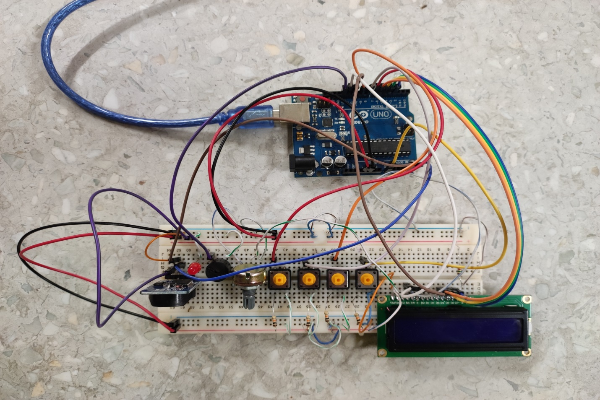
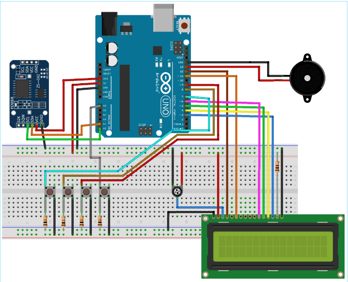

# Automatic Medicine Reminder using Arduino

An Arduino-based medicine reminder that alerts patients when it is time to take
their medication. Built around an Arduino Uno and a DS3231 real-time clock, the
device lets the user pick a dosage schedule (once, twice, or three times a day)
with push buttons, shows the current time and help text on a 16x2 LCD, and
triggers a buzzer and LED at the scheduled times (8 am / 2 pm / 8 pm slots).
The selected schedule is stored in EEPROM, so it survives power loss.

Developed as the course project for **CSE-358: Microprocessors and Assembly
Language Lab**, Department of Computer Science and Engineering, Jahangirnagar
University (April 2023), supervised by **Prof. Dr. Md. Golam Moazzam**.

## Hardware

  

| Component | Purpose |
|---|---|
| Arduino Uno | Main microcontroller |
| DS3231 RTC module | Battery-backed real-time clock |
| 16x2 LCD (parallel) | Time display, menus, reminder messages |
| Buzzer + red LED | Audible and visual alerts |
| 4 push buttons | Schedule selection (1x / 2x / 3x daily) and stop |
| 10K potentiometer | LCD contrast |
| 10K / 1K resistors, breadboard, jumpers | Wiring |

## Circuit

  

## How it works

1. On startup the LCD greets the user and shows the schedule menu.
2. The user picks a dosage frequency with the push buttons:
   - once a day (8 am), twice a day (8 am, 8 pm), or three times a day
     (8 am, 2 pm, 8 pm);
   - the choice is written to EEPROM so the device remembers it after a
     power cycle.
3. The DS3231 keeps wall-clock time; the sketch compares it against the
   active schedule each loop.
4. At a scheduled time the buzzer sounds and the LED lights until the user
   presses the stop button, after which the display returns to the clock
   screen.

## Running it

1. Wire the components as in the circuit diagram.
2. Install the `RTClib` library (Adafruit) in the Arduino IDE
   (`LiquidCrystal`, `Wire`, and `EEPROM` ship with the IDE).
3. Open `medicine_reminder.ino`, select the board/port, and upload.

## Team

Group 05 — CSE-358, Jahangirnagar University:

- Serajum Monira
- Shreya Nag Riya
- Sayeda Pervin Monika
- **Nurun Nahar Fiha**
- Ajoy Sarker
